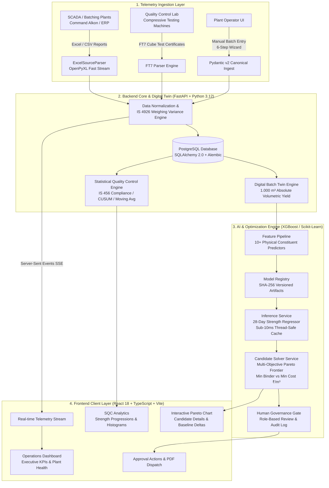

# ACC RMC AI Platform: Enterprise Ready-Mix Concrete Quality Intelligence, Digital Twin & Mix Optimization Platform

[](https://www.python.org/)
[](https://fastapi.tiangolo.com/)
[](https://reactjs.org/)
[](https://www.typescriptlang.org/)
[](https://www.postgresql.org/)
[](https://xgboost.readthedocs.io/)
[](https://scikit-learn.org/)
[](https://vitejs.dev/)
[](https://bis.gov.in/)

---

## 1. Executive Overview

The **ACC Ready-Mix Concrete (RMC) AI Platform** is an enterprise-grade digital twin, statistical quality control (SQC), and artificial intelligence optimization platform designed specifically for industrial ready-mix concrete manufacturing. 

Industrial concrete batching operations face three conflicting challenges:
1. **Compressive Strength Assurance**: Concrete must achieve guaranteed target characteristic compressive strength ($f_{ck}' = f_{ck} + 1.65\sigma$) at 28 days of water curing, yet testing results arrive 28 days *after* production.
2. **Cement Intensity & Carbon Footprint**: Cement (Ordinary Portland Cement - OPC) is the primary cost driver and carbon emitter (accounting for ~8% of global CO2 emissions). Plants routinely "over-design" mixes with excess cement to prevent catastrophic structural strength penalties.
3. **Strict Physical & Regulatory Standards**: Mix designs must strictly comply with national civil engineering standards (**IS 456:2000**, **IS 10262:2019**, and **IS 4926:2003 Annex E**) enforcing minimum binder content, maximum free water-cementitious ratios ($W/B$), and exact volumetric yield balance ($1.000\text{ m}^3 \pm 0.5\%$).

The **ACC RMC AI Platform** bridges this 28-day feedback lag by integrating automated plant telemetry ingestion (Command Alkon, SCADA, ERP), machine learning compressive strength inference ($R^2 > 0.88$, $\text{MAE} < 2.1\text{ MPa}$), multi-objective Pareto Frontier optimization (minimizing binder content and raw material costs in ₹/m³), and real-time Statistical Quality Control analytics.

---

## 2. Platform Architecture

The platform follows a decoupled, domain-driven, event-bus architecture designed for sub-second reactive plant analytics and high-throughput telemetry ingestion.



---

## 3. Core Capabilities & Workflows

### 3.1 Automated Telemetry Ingestion & Digital Batch Twin
- **Multi-Source Format Parsing**: Ingests production logs from Command Alkon, Sysdyne, and custom SCADA exports with auto-column matching and SHA-256 deduplication.
- **IS 4926 Annex E Tolerance Auditing**: Evaluates raw material batching tolerances in real time:
  - Cementitious materials: $\pm 2.0\%$ target tolerance.
  - Aggregates (Coarse & Fine): $\pm 3.0\%$ target tolerance.
  - Water & Chemical Admixtures: $\pm 1.0\%$ target tolerance.
- **Absolute Physical Yield Reconciliation**: Calculates the wet concrete compacted volume using constituent specific gravities ($G_i$):
  $$\text{Compacted Yield Volume } (V) = \sum_{i=1}^{n} \left(\frac{W_i}{1000 \times G_i}\right) + V_{\text{entrapped air}} \equiv 1.000\text{ m}^3 \pm 0.005\text{ m}^3$$

### 3.2 Machine Learning Compressive Strength Prediction
- **Algorithm Ensemble**: Multi-model training and evaluation harness featuring **XGBoost Regressor**, **Random Forest Regressor**, and **Ridge Regression**.
- **Canonical Feature Set**:
  - $X_1$: OPC 53 / 43 Grade Cement (kg/m³)
  - $X_2$: Fly Ash Class F / GGBS / Micro-silica SCMs (kg/m³)
  - $X_3$: Free Water (kg/m³)
  - $X_4$: Free Water-to-Binder Ratio ($W/B$)
  - $X_5$: Fine Aggregate / River Sand (kg/m³)
  - $X_6$: Coarse Aggregates 10mm and 20mm fractions (kg/m³)
  - $X_7$: High-Range Polycarboxylate Ether (PCE) Superplasticizer (kg/m³)
  - $X_8$: Entrapped Air Percentage ($1.0\% - 1.5\%$)
- **Performance Baselines**: Backtested on historical batch datasets achieving $R^2 > 0.88$, $\text{RMSE} < 2.6\text{ MPa}$, and $\text{MAE} < 2.1\text{ MPa}$.
- **In-Memory Caching & Fail-Safe Fallbacks**: Thread-safe inference caching delivering sub-10ms predictions, with a secondary physical heuristic fallback (modified Féret / Abrams law) if model inference exceeds timeouts.

### 3.3 Multi-Objective Pareto Frontier Optimization
The candidate solver evaluates hundreds of mix combinations against competing objectives:
1. **Minimize Total Binder Content**: Reduces clinker consumption and carbon footprint (kg CO2e/m³).
2. **Minimize Production Cost (₹/m³)**: Uses immutable price snapshots for raw constituents.
3. **Guarantee Structural Safety**: Enforces target strength $f_{ck}' = f_{ck} + 1.65\sigma$ with safety margins ($\ge +1.5\text{ MPa}$).
4. **Hard Civil Engineering Guardrails (IS 456:2000 & IS 10262:2019)**:
   - Minimum Cementitious Content: $\ge 320\text{ kg/m}^3$ (Severe Exposure).
   - Maximum Free Water-Binder Ratio: $\le 0.45$.
   - SCM Replacement Limits: Fly Ash $\le 35\%$, GGBS $\le 70\%$.
   - Total yield strictly bounded to $1.000\text{ m}^3 \pm 0.5\%$.

```text
     High Cost ▲
               │    ● Baseline Recipe (M30_STD: 320 kg Binder, ₹4,120/m³)
               │
               │         ● Sub-optimal Candidate
               │
               │      ◆ CAND-01 (Pareto Optimal: -15 kg Binder, ₹3,980/m³)
               │        ◆ CAND-02 (Balanced: -25 kg Binder, ₹3,910/m³)
               │           ◆ CAND-05 (Lowest Cost: ₹3,840/m³, +2.35 MPa Margin)
               └────────────────────────────────────────────────────────► Lower Cost
                     High Binder ◄────────────────────────► Low Binder
```

---

## 4. User Interface & Live Dashboard

The frontend is an industrial-themed, responsive dashboard built with **React 18**, **TypeScript**, and **TailwindCSS**, featuring custom domain-accurate SVG engineering pictograms.


### UI Functional Modules:
1. **Executive Operational KPIs**:
   - Total Produced Volume (m³) with monthly growth trends.
   - Batch Count, Plant Utilization, and IS 456 Quality Compliance Score.
2. **Statistical Quality Control (SQC) Suite**:
   - 28-Day Strength Normal Distribution Histogram with Gaussian fit curve.
   - Moving Average & Target Line ($f_{ck} + 1.65\sigma$) Progression Charts.
   - 7-Day to 28-Day Strength Correlation Scatter with error bands.
3. **IS 4926 Material Weighing Variance**:
   - Variance cards for Cement, Fly Ash, Water, Aggregates, and Chemical Admixtures.
   - Live color-coded status badges: `COMPLIANT` (<= 2%), `WARNING` (2% - 3%), `OUT OF TOLERANCE` (> 3%).
4. **AI Mix Optimization Workspace**:
   - Interactive Pareto Frontier Scatter Plot with tooltips and candidate selector.
   - Real-time candidate evaluation scorecard (Predicted Strength, Binder Delta, Cost Delta in ₹/m³).
   - Dynamic Recipe Impact & Baseline Comparison matrix with absolute volume breakdowns (m³).
5. **Governance & Approval Gating**:
   - Role-based human review actions (`APPROVE CANDIDATE`, `REQUEST MODIFICATION`, `REJECT`).
   - Tamper-proof cryptographic audit logging with timestamped user attribution.

---

## 5. Technology Stack

| Domain | Technology / Tool | Version | Role in Platform |
| :--- | :--- | :--- | :--- |
| **Backend Core** | **Python** | `3.12+` | High-performance asynchronous runtime |
| **API Framework** | **FastAPI** | `0.115.0+` | RESTful API, validation, and SSE streaming |
| **Data Access & ORM** | **SQLAlchemy** | `2.0.38+` | Unit of work, typed models, connection pooling |
| **Schema Migrations** | **Alembic** | `1.14.1+` | Canonical schema migration lifecycle |
| **Database** | **PostgreSQL** | `16.x` | Production transactional relational database |
| **Dev Database** | **SQLite** | `3.x` | Zero-dependency local integration test database |
| **Serialization** | **Pydantic v2** | `2.13.4+` | Strict type validation and domain contracts |
| **Machine Learning** | **XGBoost** | `2.1.0+` | Gradient boosted decision trees for strength forecasting |
| **Machine Learning** | **Scikit-Learn** | `1.5.0+` | Random Forest, Ridge regression, preprocessing pipelines |
| **Math & Optimization** | **NumPy & SciPy** | `1.26+ / 1.13+` | Volumetric balancing, Gaussian fitting, Pareto solvers |
| **Data Parsing** | **OpenPyXL** | `3.1.5+` | High-speed multi-tab spreadsheet parsing engine |
| **Frontend Runtime** | **React** | `18.2.0` | Declarative reactive UI components |
| **Language** | **TypeScript** | `5.2.2` | Strict client-side typing & contract generation |
| **Frontend Bundler** | **Vite** | `5.1.6` | Optimized modern ES module bundling (< 2s builds) |
| **Navigation** | **React Router** | `6.22.3` | Client-side routing with sub-view deep linking |
| **Styling & Icons** | **TailwindCSS** | Custom | Responsive layout with custom industrial SVG pictograms |
| **Web Server / Proxy** | **Nginx** | `1.18+` | Reverse proxy, SSL termination (Let's Encrypt), static cache |
| **Process Supervision**| **Systemd** | Linux | Zero-downtime service lifecycle & health daemon |
| **Hosting Platform** | **Ubuntu Linux** | `24.04 LTS`| Dedicated cloud VM hosting (Linode) |

---

## 6. Directory Structure

```text
acc-rmc-ai-platform/
├── docs/                               # Architectural blueprints & engineering specifications
│   ├── images/                         # System diagrams and UI screenshots
│   └── WS01_Implementation_Plan.md     # Granular implementation workstream plans
├── frontend/                           # React 18 + TypeScript + Vite frontend
│   ├── src/
│   │   ├── components/                 # UI components
│   │   │   ├── dashboard/              # Executive KPIs, SQC, and Material Variance cards
│   │   │   │   ├── ai/                 # Pareto Frontier, Candidate Details, Cost & Recipe Deltas
│   │   │   │   └── sqc/                # Histograms, progressions, break correlations
│   │   │   ├── icons/                  # Realistic industrial SVG vector pictograms
│   │   │   └── navigation/             # AppSidebar and AppNavbar
│   │   ├── pages/                      # OperationsDashboardPage, IngestionPage, etc.
│   │   └── services/                   # API clients and SSE event stream consumers
│   ├── package.json
│   └── vite.config.ts
├── src/                                # FastAPI backend core application
│   ├── ai/                             # Feature stores, training pipelines, and dataset builders
│   ├── api/                            # RESTful route controllers and SSE streaming endpoints
│   ├── core/                           # Business engines (Pareto Solver, Yield Reconciliation)
│   ├── database/                       # SQLAlchemy models, sessions, and Alembic migrations
│   ├── domain/                         # Domain models, state machines, and business rules
│   ├── ingestion/                      # SCADA, Command Alkon, and Excel parser connectors
│   ├── ml/                             # Scikit-learn & XGBoost inference and registry services
│   │   ├── inference/                  # Thread-safe model caching and predictor engine
│   │   └── registry/                   # SHA-256 artifact storage and state machine
│   └── security/                       # JWT authentication, RBAC, and audit logging
├── scripts/                            # Production deployment, sync, and audit automation scripts
├── pyproject.toml                      # Python package configuration and linting rules (Ruff, Mypy)
├── requirements.txt                    # Production Python dependencies
└── README.md                           # Master platform documentation
```

---

## 7. Installation & Local Development

### Prerequisites
- Python 3.12 or higher
- Node.js 18.x or 20.x and npm
- PostgreSQL 15+ (or built-in SQLite fallback)

### 1. Backend Setup
```bash
# Clone the repository
git clone https://github.com/acc-concrete/acc-rmc-ai-platform.git
cd acc-rmc-ai-platform

# Create and activate virtual environment
python3 -m venv venv
source venv/bin/activate  # On Windows: .\venv\Scripts\activate

# Install dependencies
pip install -r requirements.txt

# Run database migrations
alembic upgrade head

# Start FastAPI server
uvicorn src.api.main:app --host 0.0.0.0 --port 8005 --reload
```
The backend API documentation will be available at `http://localhost:8005/docs`.

### 2. Frontend Setup
```bash
cd frontend

# Install node dependencies
npm install

# Run Vite development server
npm run dev
```
The frontend dashboard will be available at `http://localhost:5173/acc/dashboard`.

### 3. Running Test Suites
```bash
# Run backend pytest suite
pytest tests/ -v

# Run frontend test suite
cd frontend && npm test
```

---

## 8. Production Deployment & DevOps

The platform is deployed in production on a dedicated cloud Linux instance (**Ubuntu 24.04 LTS**) under the following architecture:
- **Systemd Service**: Managed via `acc-rmc-backend.service` running Uvicorn workers on port `8005`.
- **Nginx Reverse Proxy**: Handles SSL/TLS termination, HTTP/2 multiplexing, static asset caching with gzip/brotli, and proxies API / SSE requests.
- **Automated Deployment**: Custom atomic deployment script creates versioned tarballs, executes `tsc && vite build`, syncs compiled bundles via SSH/SCP, executes migrations, and issues a zero-downtime systemd reload.

---

## 9. Standards & Civil Engineering Compliance

This software rigorously implements and validates against the following Bureau of Indian Standards (BIS):
- **IS 456:2000 (Plain and Reinforced Concrete - Code of Practice)**: Table 5 environmental exposure conditions, minimum cementitious contents, and maximum water-cement ratios.
- **IS 10262:2019 (Concrete Mix Proportioning - Guidelines)**: Specific gravity calculations, target characteristic mean strength curves, aggregate blending, and mineral admixture limits.
- **IS 4926:2003 (Ready-Mixed Concrete - Code of Practice)**: Annex E operational batching accuracy limits and tolerance enforcement.
